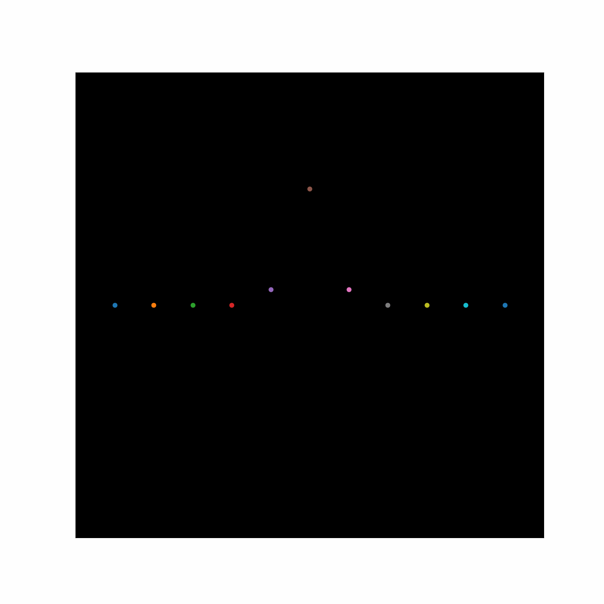

# Time-dependent Schrödinger equation

**Finite-difference and Crank-Nicolson solutions in one dimension**

[](LICENSE)
[](https://www.python.org/)
[](https://www.scilab.org/)

This repository solves the 1D time-dependent Schrödinger equation for a Gaussian
wave packet in several potentials. It contains two implementations:

- **`crank-nicolson/`** is the current Python solver. It uses the Crank–Nicolson
  scheme with a complex absorbing potential at the boundaries and is the version
  I recommend for actual use.
- **`main.sce`** and **`normalized/`** are the original Scilab finite-difference
  implementation written for a course project. The explicit scheme is stable only
  for short runs and the wave packet eventually grows without bound. The
  Crank–Nicolson version was written to fix that.

**Author:** Zain Ul Abideen
**GitHub repository:** [dominuszain/TimeDependentSchrodingerEquation](https://github.com/dominuszain/TimeDependentSchrodingerEquation)



## Crank–Nicolson solver

```bash
cd crank-nicolson
pip install numpy scipy matplotlib
python schrodinger_sim.py
```

The solver opens an interactive window with three presets: a harmonic trap, a
Gaussian well, and a finite square well. Sliders and buttons switch between
potentials while the probability density evolves. The method is described in
[`crank-nicolson/DETAIL.md`](crank-nicolson/DETAIL.md).

## Original Scilab implementation

Open `main.sce` in Scilab and run it. The script discretises the wave function on
a 51-point grid and steps it forward in time with an explicit finite-difference
update. `normalized/` contains the same calculation with a renormalised wave
function, and `normalized/much_better/` uses a Gaussian potential that delays the
numerical blow-up.

The original report is [`main.pdf`](main.pdf). Rendered examples are in
[`docs/`](docs/):

- [`docs/tdse.mp4`](docs/tdse.mp4)
- [`docs/schrodinger-gaussian-1.mp4`](docs/schrodinger-gaussian-1.mp4)
- [`docs/schrodinger-gaussian-2.mp4`](docs/schrodinger-gaussian-2.mp4)

## Repository layout

```
.
├── crank-nicolson/          # Python Crank-Nicolson solver (recommended)
├── normalized/              # original Scilab code, renormalised variant
├── MatplotlibAnimation/     # animation of the sampled wave packet
├── docs/                    # rendered videos and figures
├── main.sce                 # original Scilab finite-difference code
├── main.pdf                 # course report
└── LICENSE
```

## Method

With ħ = m = 1, the equation is

```
i ∂ψ/∂t = (-1/2 ∂²/∂x² + V(x)) ψ
```

The Scilab version advances the real and imaginary parts separately with an
explicit finite-difference update on a uniform grid. The Python version uses the
trapezoidal Crank–Nicolson update

```
(I + iΔt/2 H) ψⁿ⁺¹ = (I - iΔt/2 H) ψⁿ
```

with a tridiagonal Hamiltonian and a complex absorbing potential near the grid
edges to suppress reflections.

## Citation

The repository has no separate DOI. If you use it, please cite the code and the
course report:

```bibtex
@software{ulabideen_tdse_2026,
  author = {Ul Abideen, Zain},
  title  = {Time-dependent Schrödinger equation: finite-difference and Crank-Nicolson solutions},
  year   = {2026},
  url    = {https://github.com/dominuszain/TimeDependentSchrodingerEquation}
}
```

## License

Released under the [MIT License](LICENSE).
